# Qlourie Astral R — 26.10.26

**English** | [简体中文](./26.10.26.zh-CN.md)

**THIS IS A HUUUGUUUUUUUUUUUUUUUUUUGGGGGGGGGGGGGGGGGGGGGE UPDATE. IT BASICALLY TRANSFORMED EVERYTHING TO A NEW LEVEL.**

**If you want to know what changed exactly underneath, I hope you'll read on.** With more reference manuals to work from, I've reworked much of the powertrain, suspension kinematics and weight distribution. **Actually better or worse, some aspects have become extremely realistic, but are probably less ideal than before**.

**OLD TUNING FILES ARE PROBABLY NOT COMPATIBLE.** Many suspension part names, slots and tuning variables have changed. Start with the updated supplied configurations when comparing the handling; old setups may retain obsolete values or load different defaults.

Below language maybe be refined by Codex since English is not my primary language.

## Chassis and bodywork

Since my laptop died as said before, below screenshots are taken from my MSI CLAW 8 AI so the graphics are low.

- Relocated the indicators and removed the old indicator meshes.\
  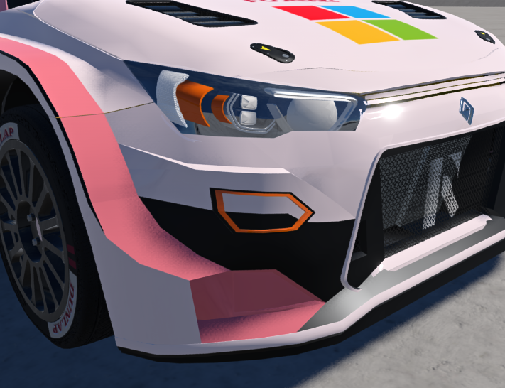

- After researching modern WRC cars, I found that they generally avoid lower brake-cooling intakes to reduce drag. I removed those intakes and routed the brake-cooling air through the grille.\
  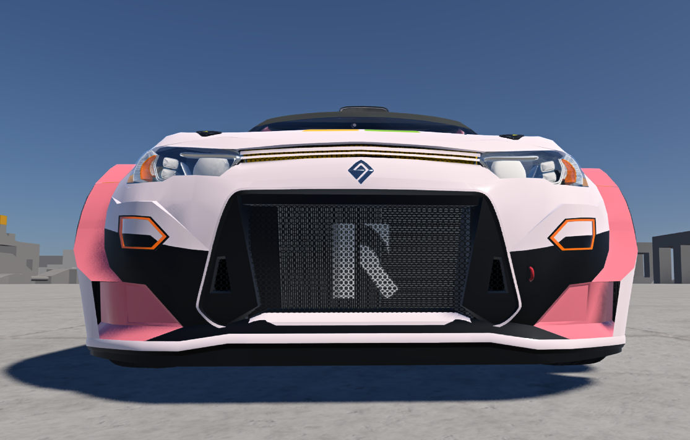\
  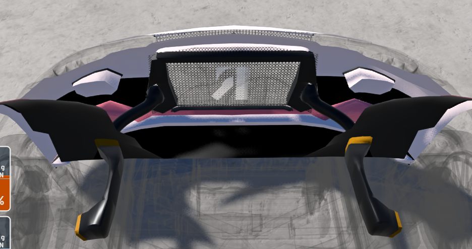

- **REWORKED THE WEIGHT DISTRIBUTION BETWEEN THE CHASSIS, BODY PANELS AND POWERTRAIN**
  - Previously, I used engine and chassis node weights to account for too much of the difference between variants. The minimum weights are 1190 kg for WRC17 and 1230 kg for Rally2: a 40 kg gap. I doubted that the engine and chassis alone could explain it, given their reinforcements and weld points.
  - The Polo GTI R5 homologation documents led me to revisit body-panel materials. WRC allows more use of composites, while Rally2's regulations and cost cap favour heavier steel for panels such as the doors, hood and tailgate.
  - The Rally2 engine assembly is now lighter and the WRC17 assembly slightly heavier than in 26.08.18, reducing the artificial gap between them. The chassis weight difference is also much smaller.
  - Xtrac R5 transmission data, covering the front transaxle and rear differential, led me to increase transmission weight. I offset this by lightening the central and rear underguards, whose old weights overlapped with structures already represented by neighbouring nodes.
  - One BeamNG node can support an engine mount, a transmission attachment and part of the chassis at once. These weights therefore represent shared assembly budgets, not isolated components on a scale.

- **MOVED THE ROLLCAGE INTO CHASSIS MODIFICATION**
  - The cage's nodes, beams and flexbodies now belong to the chassis modification, instead of being a separate removable cage part.
  - An interview about the Polo GTI R5 highlighted how cost and regulations contribute to a heavier Rally2 cage than a WRC cage. I added a Rally2 specification weighing about 47.8 kg.

- Added steel door, hood and tailgate variants.

- Adjusted seat and fuel-tank node positions. **BeamNG 0.40's occupant feature is not integrated yet; its effect on weight and centre of gravity needs evaluation.**

- Reworked chassis, subframe and powertrain mounting connections.

- Moved the Rally2 wing assembly 40 mm forward and adjusted the shared wing / tailgate node weights.\
  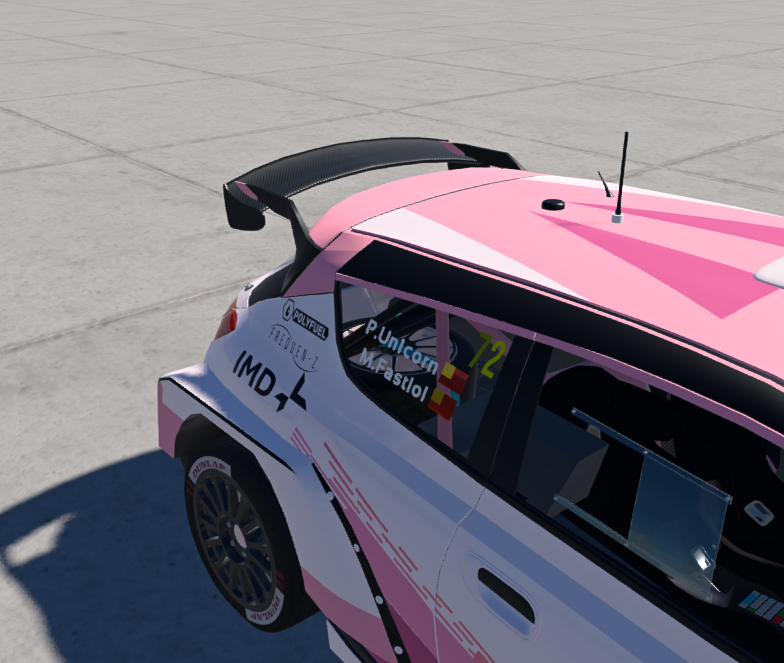

- Reduced drag on several body parts, increasing the lift-to-drag ratio.

- Updated bodywork flexbody assignments, material references and some collision / aerodynamic triangles alongside the structural changes.

## Engine and transmission (THIS IS HUGE!)

- **SEPARATED THE TURBO HARDWARE FROM ITS RESTRICTOR**
  - This started with a fairly simple question: why did I need to write a whole new turbo curve whenever I changed the restrictor? Previously, each restrictor part carried its own complete calibration, along with the intercooler structure.
  - The useful discovery was that the restrictor's effect could be separated into an RPM-dependent correction. It has little effect at low flow demand, then progressively limits the mid- and high-RPM output. This also lets a larger opening extend the torque platform and power band without multiplying the entire engine curve by the hole-area ratio.
  - There are now three turbo assemblies: **turboB** for Rally2 / WRC16 with 32 / 33 mm restrictors, **turboA** for WRC17 / Rally1 with 36 / 35 mm restrictors, and **turboRX** for RX1 with a 45 mm restrictor. All three assemblies can be selected on either engine size; the restrictor choices follow the selected turbo. Each assembly owns its base turbo curve, intercooler meshes, nodes and beams, and turbo mounting beams.
  - The restrictor parts now contain only a `components` correction applied to the base `engineDef` curve. **Removing the restrictor sets that correction to zero**, so the unrestricted curve appears automatically. Changing the opening keeps the selected turbo, ECU calibration and boost settings, with the larger opening giving more mid- and high-RPM output.
  - Sharing turbo hardware still leaves room for each engine's own calibration. I refitted the naturally aspirated base curves and model-specific corrections together, keeping the WRC17 / Rally1 base curves at least as high as Rally2 / WRC16 through the working RPM range.
  - **The six main turbocharged specifications retain their existing restricted power and torque peaks.** Their curves are also almost unchanged, including the strong output already available around 3000 RPM. Existing wastegate settings are retained for this release.
  - The supplied configurations now select the matching turbo assembly. The intercooler and its weight stay with that assembly when the restrictor is removed.

- Slightly reduced engine torque in the redline range.

- Reduced engine-block beam stiffness to improve stability.

- Rebalanced engine, gearbox, transfer-case and rear differential node weights, and revised their supporting beams and mounts.

- Rebalanced engine / exhaust gains and gear-whine levels for the sound changes in BeamNG 0.40.

- Moved throttle-map calibration into the individual ECU data, so each engine specification can have its own curves.

- Made the default throttle maps much less aggressive. **Subtle Linear** maps now have a more linear response.\
  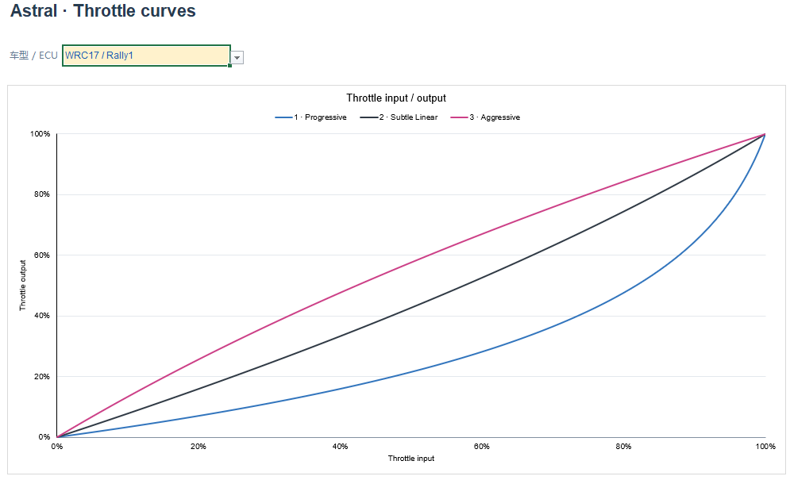

- Reduced RX throttle maps to two and retuned their response.

- **FINAL DRIVE AND GEARBOX REWORK**
  - Research into the center driveline and its torque calculations led me to revise the powertrain layout.
  - Previously, the front and rear differentials provided the entire final reduction, similar to the Subaru WRX ARA layout. A 2020 FIA document on the Rally1 hybrid system gives a typical WRC rear differential ratio of 2.5–3.5. Further research showed that **this is not the overall final-drive ratio**.
  - Standardized gear-set names around tooth counts, including **15x62** for the Rally2-related main final drive and **15x67** for WRC17.
  - Using several transverse-engine Rally2 cars as references, I moved the main reduction into the transfer-case powertrain device. The front differential now runs at **1:1**, and the gearboxes share the main final-drive selection.
  - The AWD rear output uses a **34x13 output gear set** followed by a **13x34 rear gear ratio**. Their reciprocal ratios cancel, matching front and rear axle speeds while keeping the rear reduction within 2.5–3.5. This follows the same speed-up / reduction arrangement found in the i20 N Rally2 and Polo GTI R5.
  - WRC17's shorter final drive reduces top speed from about 193–194 km/h to 191 km/h, measured with the Type-A tarmac setup.
  - Reworked WRC16's two six-speed gear sets around the same **15x62 final drive as Rally2**. Both sets are shorter overall, while keeping their existing gear spacing and the resulting RPM drop on upshifts.

- Added dedicated gear sets for RX1 and RX3. RX3 now has a five-speed set targeting about 169 km/h, with slightly taller first and second gears.

- **RECALIBRATED TORQUE VALUES FOR THE NEW FINAL-DRIVE LAYOUT**
  - With the main reduction now upstream and a 1:1 ratio from the transfer case to the front axle, the front torsion reactor and center coupling operate at higher shaft torques.
  - The higher reaction torque produces more chassis flex, though not visible, only measurable from debug at the front wheels under power, braking and shifting. Increasing the subframe torque-mount stiffness alone did not remove all of it.

- **REBUILT THE ACTIVE CENTER DIFFERENTIAL'S MAP CALCULATION**
  - This exposed a mistake in my original active-center calibration target. I had used **100–200 Nm**, but the behaviour I intended called for roughly **447–894 Nm at the former center-differential shaft**, using a final-drive ratio of about **4.47**. The old setting needed to be multiplied by about 4.5 to reach the intended braking lock.
  - Expressing that revised target at the new shaft location after moving the final reduction gives roughly **2000–4000 Nm**. These are two separate changes: correcting the target, then converting its shaft reference. The resulting range is comparable to the locked split shaft and **RBR NGP's default 3000–4000 Nm range**.
  - To retain the old layout's **20 Nm center-preload effect**, the coast and throttle maps now receive **20 × the selected final-drive ratio**. With WRC17's 15x67, that is about **89.3 Nm at the current center differential**. This conversion happens once in JBeam, so the calibration follows final-drive changes without another multiplier in Lua.
  - Braking preload is now **15x–60x the same base preload**, rather than a fixed torque setting. It works alongside the input-torque-dependent LSD term: the amplified preload dominates at high brake-map gains, while engine braking can still provide hundreds of Nm of driveline torque from around 45 Nm at the engine, depending on gearing. **The balance between the two locking contributions changes with pedal input and gear ratio.** With the default 40x multiplier and WRC17's 15x67 final drive, the braking preload contribution can reach about **3573 Nm**.
  - Replaced independent pedal start / maximum settings with **start + travel through the remaining pedal range**.
  - Reorganized the steering controls as **Steering Lock Cut** and **Speed Map Factor**. Increasing either retains more lock where that control applies.
  - Replaced abrupt map switching with **weighted map blending**, giving a **20 ms transition** between coast, throttle and braking preload.
  - Matched controller variable names to their JBeam inputs.
  - Removed the coast-threshold slider and fixed the threshold at 5%.
  - Fixed the repeated steering reduction in the braking calculation.

- **RECALIBRATED MECHANICAL LSDs**
  - Removed the friction-face multiplier from preload.
  - Simplified the ramp calculation and fitted it to the reference data. The previous formula was correct as well but more complicated; the new curve makes the **ramp-dependent locking contribution reach 0% at 85 degrees rather than 90 degrees, and it's mathematically correct**.
  - The front drive-ramp choices are now 46 / 50 / 62 degrees, each with 70 / 80-degree coast options.
  - The rear choices are now 40 / 46 / 54 degrees, with 80-degree coast.
  - The differential workbook and in-game parts now use the same curve. Its displayed locking percentage consistently follows the project's **2 × lsdLockCoef** convention.\
    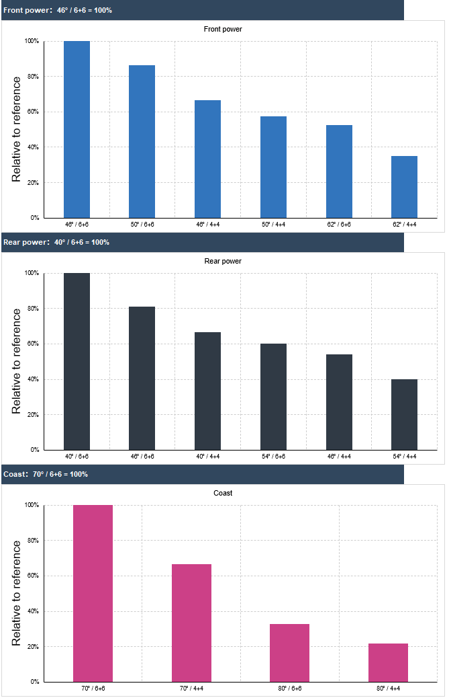

- Mechanical center preload now uses **tuning value × selected final-drive ratio**, following the same calibration basis. The revised ramp calculation also applies to it.

- Reduced clutch lock-spring stiffness from **0.365 to 0.28** to reduce the sharp load transfer during gear changes, particularly braking downshifts.

- Retuned transmission friction values.

- Added **multiShiftLights.lua**, based on the vanilla shiftLights.lua, with a separate flashing RPM for each gear. The ECU supplies the thresholds; the old shift-light tuning sliders have been removed.

- Updated shift-light RPMs for the different cars.

- Added a shift-light calibration workbook.\
  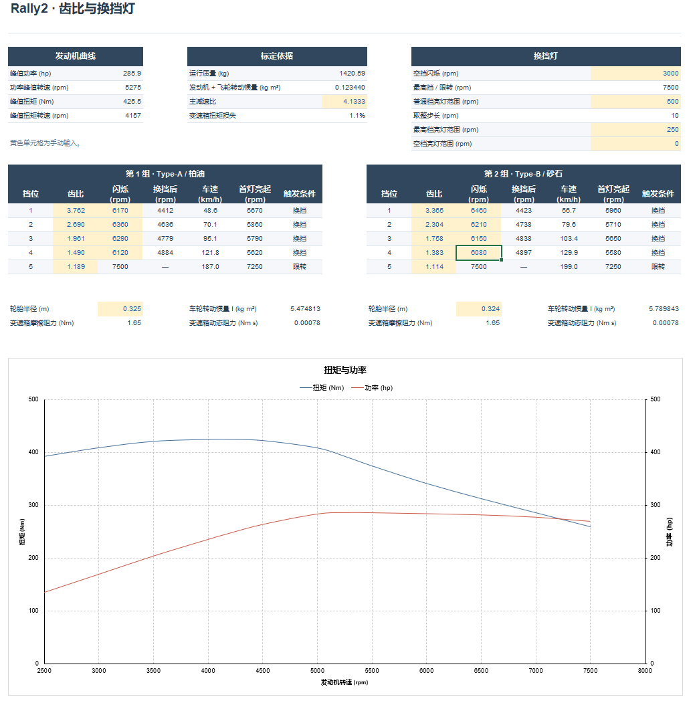

- Added a separate Rally1 ECU settings entry so its five-speed setup does not have to share WRC17's six-speed light settings.

- Hid the experimental engine-map / ALS tuning controls for now. Further eWastegate, ALS and launch-control development is reserved for a later update.

## Suspension (THIS IS EVEN BIGGER!)

- Rebalanced bump and droop travel on some configs to reduce bottom out after impact.

- Retuned RX3 springs to **30 N/mm front / 32 N/mm rear** and revised the front spring length.

- **NEW MESHES AND LORE FOR ALL WHEELS**
  - Now the lore is set where, tyre supplier called **Terrastride** where **Vector** is for tarmac, **Strata** is for gravel, **Rime** is for ice/snow and **Flux** for RX. Wheel supplier is called **Meridian Competition**. **(YEAH I KNOW I'M BAD AT NAMING SO THANKS TO AI AND THE TEXTURE IS YET TO BE DONE)**
  - Tarmac wheels have 15 spokes and gravel wheels have 11, matching the real-world references.\
    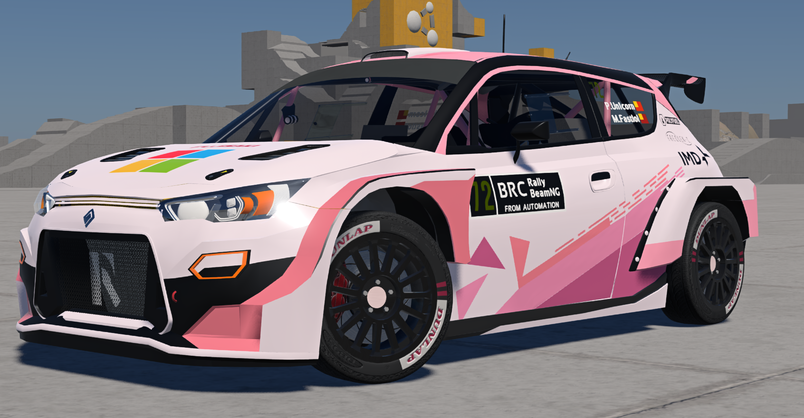\
    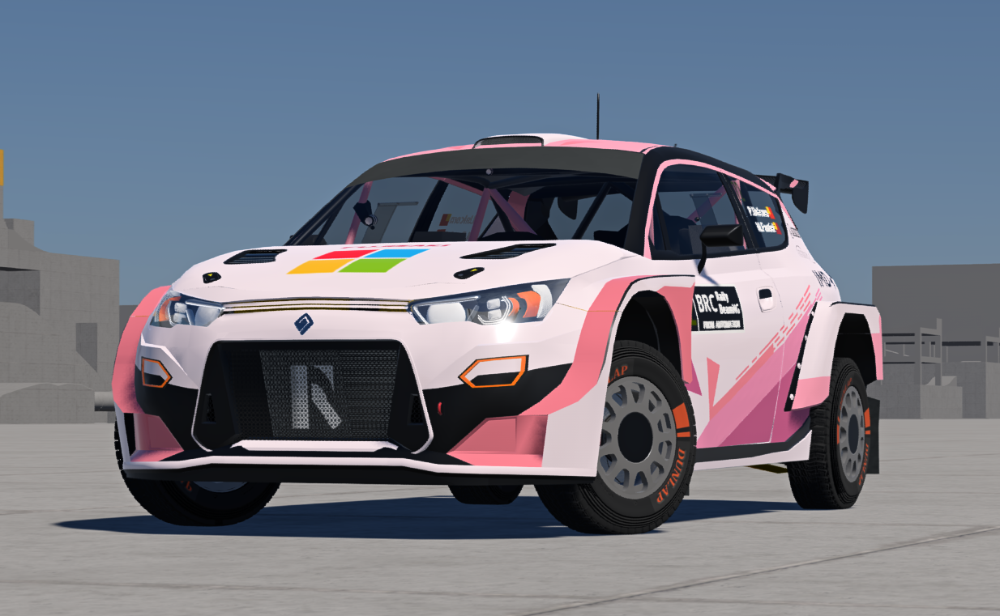\
    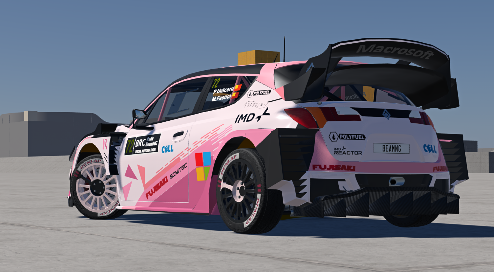
  - Rebuilt the meshes from scratch for cleaner topology.
  - Separated the colour schemes from the wheel models so they can be selected across the variants.
  - Referenced tyre dimensions from ACB11, Pirelli Scorpion and P Zero data. **Nominal labels such as 235 and 205 do not necessarily match the measured tyre width.**
  - Rebuilt the gravel tyre mesh with a more symmetrical shape.\
    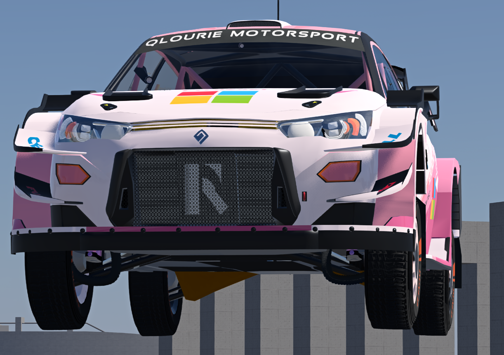
  - Separated rim parts from tyre definitions and reorganized the hub, flexbody and slot data. Updated rim choices and naming to work with BeamNG's wheel-size selector.\
    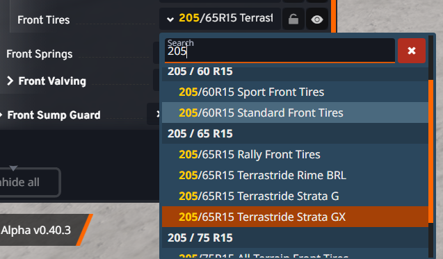
  - Adjusted tyre load sensitivity, tread, sliding behaviour and sidewall support, and updated some tyre-width / sidewall parameters.

- **REDUCED UNSPRUNG MASS AND REWORKED THE SUPPORTING STRUCTURE**
  - Repeated observations changed my baseline: **real suspension parts are not as stiff as I had assumed, and reducing weight involves compromises**. This could be seen in various slow-motion shots, where the fast shake/vibration during high impacts are presented even IRL.
  - **Real subframes are light.** Sources describe weight limits, while the Polo GTI R5 homologation documents and C3 Rally2 parts data put them at around **12 kg**. In BeamNG, I cannot simply make fx1 + fx2 + fx3 + fx4 total 12 kg: those nodes also carry other structures and would explode if too light.
  - After testing, fx1 and fx2 are around 4.5 kg per node, with lower weights for fx3 and fx4. The first pair also represents parts of the control arms; the latter pair shares chassis mass. **Subframe beam stiffness is about 16–33% lower.** This reduction seemed to have little effect on flex, given the margin in the original beams.
  - Reduced unsprung mass in the upright, control-arm and steering connection nodes, damper lower ends and gravel brake nodes. Increased tarmac brake-node weight to account for the larger discs.
  - Revised the control-arm beams, camber links, rails, steering connections and subframe mounts. **Despite the moderate stiffness reduction, combined with much less weight, the assembly surprisingly became more stable and rigid in testing.**
  - With calculations from Codex, relocated the structural damping beams so they interfere less with damper movement.
  - In driving tests, the lighter suspension responded more quickly and felt more natural over the surface. It also exposed sharper steering feedback and some small unloaded-wheel movements that had previously been suppressed by the heavier assemblies.

- **REWORKED THE SUSPENSION GEOMETRY: ROLL CENTERS, INSTANT CENTERS AND FVSA**
  - Repositioned lower ball-joint hardpoints, including **fh1**, and revised the related control-arm geometry.
  - Used measured in-game node positions at running ride height to recalculate the **instant centers (IC), roll centers (RC) and front-view swing-arm lengths (FVSA)**.

- Added **Low / High control-arm mounting points**. The front adjustment changes the anti-dive geometry; the rear adjustment provides a suspension-geometry option for tarmac.

- Reorganized these controls with camber, toe and caster under **Alignment**. Removed track-width tuning.

- Fixed the steering-rack height and replaced the rack-shim adjustment with a front **Bumpsteer Spacer**, acting at the outer steering connection like the rear adjustment.

- **A MAJOR FINDING: THE STOPS WERE ADDING DAMPING IN THE WRONG DIRECTION**
  - The old mechanical rebound-stop setup could add substantial damping while the suspension was compressing. Likewise, the mechanical bump-stop setup could resist the suspension as it extended away from compression.
  - I originally included that damping to represent the stop material recovering after compression. **But once the piston moves away, the stop no longer stays in contact with it.** The stop may resist its own recovery, but that should not keep damping the departing piston in JBeam.
  - This was especially noticeable around the ends of travel. Some of the twisting or hesitation had led to heavier nodes and stiffer structure being used to contain it.
  - Removed the excessive opposite-direction damping and standardized those small background values at **100 N·s/m**, while retaining the intended end-stop action.
  - Mechanical rebound-stop stiffness is now **654,114 N/m at the front** and **400,100 N/m at the rear**. Softening the rear brings its end-stop deflection closer to the front, at about 4–5 mm on both axles.
  - Mechanical bump stops are calibrated by surface and specification. Gravel retains its own settings; ordinary tarmac uses **651,000 N/m front / 551,000 N/m rear**, while Rally2 tarmac retains its separate **675,000 / 565,000 N/m** adjustable setup.
  - Considering progressive bump stops, tuning changes the boundZone rather than the spring stiffness. Corrected the trigger points and bound zones, including Rally2's adjustable tarmac stops.
  - Mechanical bump-stop length is now **17 mm on WRC17 tarmac suspension and both RX variants**. Rally1 tarmac uses **27 mm at the front and 17 mm at the rear**, with the same **220 mm nominal damper stroke** at both ends. With equal HBS travel settings, the front HBS engages **10 mm earlier** than the rear.
  - Reduced hydraulic rebound-stop damping to **2000 N·s/m on gravel** and **3000 N·s/m on tarmac**.
  - Standardized the small spring terms in all hydraulic bump and rebound stops at **100 N/m** and corrected left / right mismatches.
  - This made it possible to reconsider the suspension mass and stiffness on their own merits, rather than keeping excess mass to hide an unwanted damping effect.

- **REWORKED THE DAMPER CURVES, ADJUSTERS AND MODEL RANGE**
  - The fictional damper range now follows a tier structure similar to real brands: series 3, 4, 6 and 8. The mod uses series 6 and 8.
  - Renamed the range from MRA / MRX to **RA**: RA60 / RA65 for Rally2 tarmac / gravel, RA80 / RA85 for WRC17, RA80/2 / RA85/2 for Rally1, and RA88 / RA68 for RX1 / RX3.\
    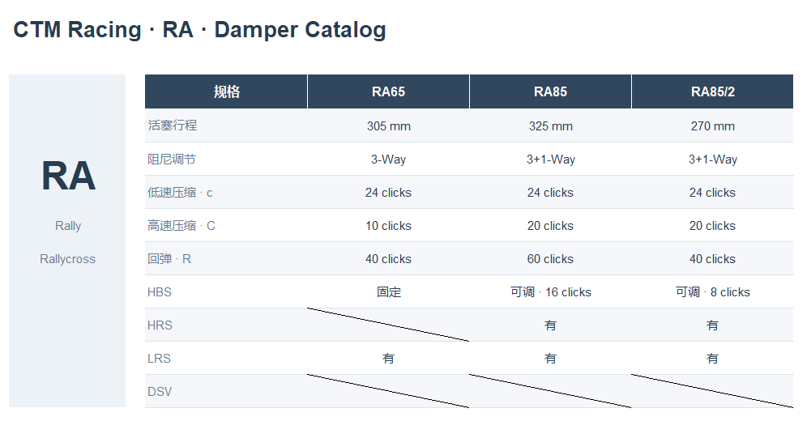
  - Reorganized the JBeam files around separate valving slots. Parent parts pass in the tuning variables, while the components section holds the calculations and values.
  - Research led to a different approach to LS and HS adjustment. Below, low-speed compression is **LSC / c**, high-speed compression is **HSC / C**, and rebound is **R**.
  - Type-A has a **3-stage curve**. Damping rises at slightly higher rate at low speed; at the **first knee**, oil pressure opens the preloaded valve and the slope drops slightly. At the **second knee**, the shim-stack effect makes the curve more progressive as piston speed rises. Type-B is mostly digressive after the first knee, although its high-speed slope can rise again with some shim-stack settings.\
    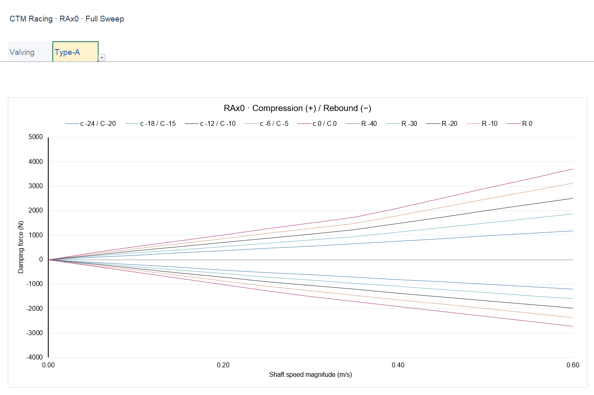
  - LSC changes the slope without moving the knees. Type-A's HSC adjusts the second knee and the slope beyond it; Type-B's HSC adjusts the first knee. **The damper workbooks let you inspect these curves with an interactive calculator.**\
    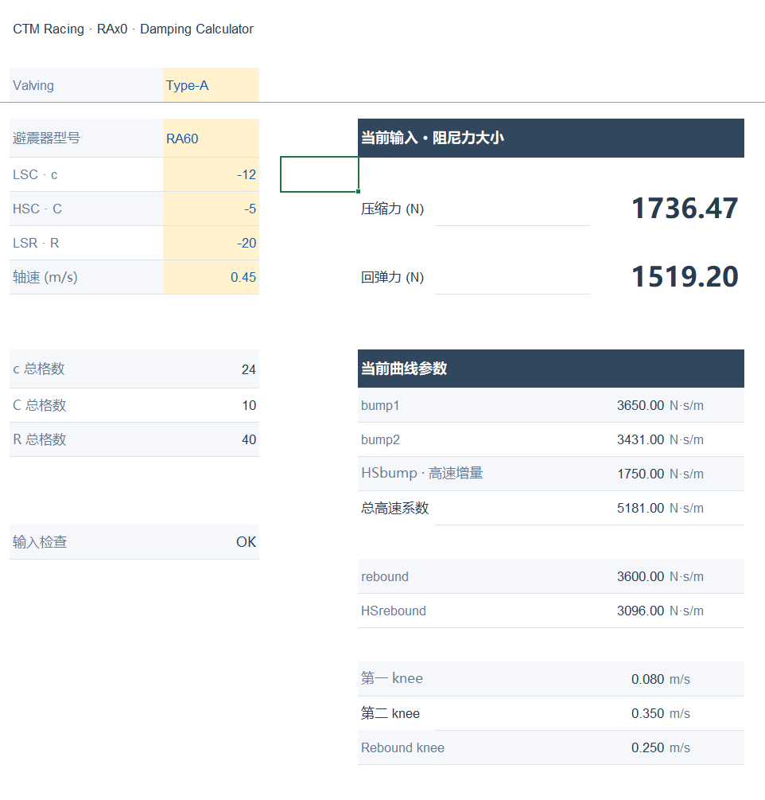
  - Retuned the size of the click changes. Gravel, tarmac and RX have their own working ranges rather than sharing a curve only rescaled by name.
  - The 6-series has **10 HSC clicks**; the 8-series has **20 HSC clicks** and retains adjustable hydraulic bump-stop damping.
  - Made HRS damping fixed where the system is fitted.
  - Removed HRS from **RA60, RA65 and RA80/2**.
  - RA88 is **3+1-Way**, while RA68 uses the 6-series arrangement.
  - RA80 and RA85 have 60 rebound clicks; the other models have 40.
  - **Removed the separate LRS multiplier slider** and organized the blocker under the selected valving.
  - Removed DSV from WRC17 gravel suspension. The planned DSV application is RA80 only.

- **LRS NOW READS THE DAMPER THAT IS ACTUALLY INSTALLED**
  - Removed the duplicate JBeam damping tables. Lua now builds its data from the named physical damper beams during initialization.
  - Included the additional HS beam when reporting the full compression curve. The transition velocities are labelled velocity 1 / velocity 2, since different valve designs do not share one definition of an HS knee.
  - The selected valving now determines the LRS multiplier, allowing separate Type-A and Type-B rebound-relief factors for gravel, tarmac and RX.
  - **The LRS factor follows the rebound adjuster through a ±0.05 range:** softer rebound uses less relief; firmer rebound allows more relief when LRS opens.
  - Retuned the trigger thresholds.
  - Added selectable per-wheel live debugging for opening / closing behaviour.

- **REBUILT THE ANTI-ROLL BARS AROUND ADJUSTABLE CANTILEVERS**
  - I originally used cantilever length adjustment, but switched to the control-arm pickup adjustment seen on manuals I had at that time. On this car's geometry, it needed awkward positioning to produce a useful motion-ratio change.
  - After researching I've found that actually, designs use holes along the cantilever to change its effective length, this is also very common. Examples include the rear of the Polo GTI R5 and **GR Yaris Rally1**, as well as Subaru's ARA car and TCR cars.
  - I replaced the lower-pickup adjustment with three effective cantilever lengths: **L / M / H**. The difference between settings is much more useful now!
  - Added **solid and lightweight cantilevers**, reflecting the cost and regulatory differences between Rally2 and WRC. Each part owns its nodes and beams, so the selection also changes its weight.\
    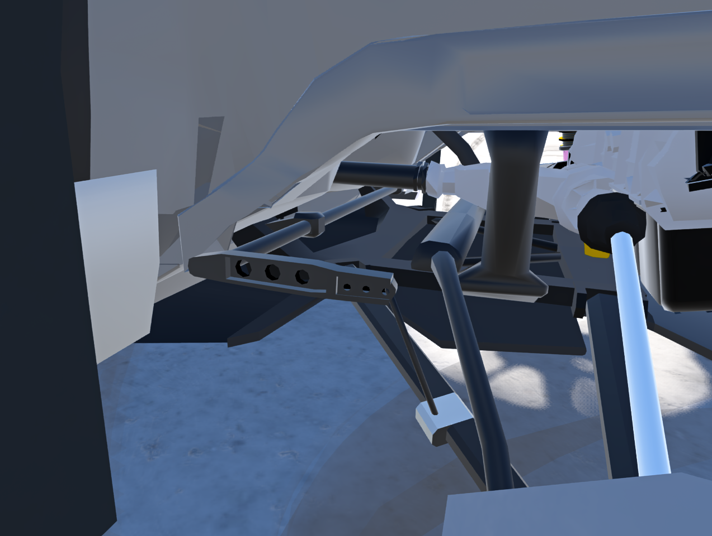\
    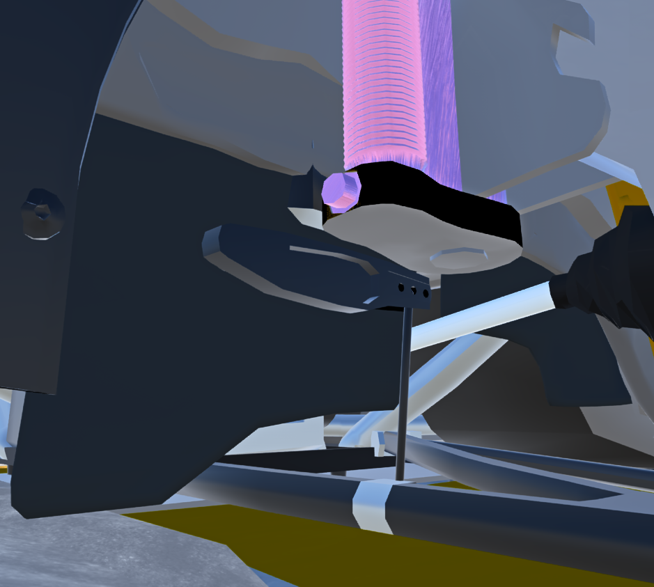
  - Rebuilt the meshes from scratch and used props for the cantilevers, so the visible geometry follows the selected ARB position.\
    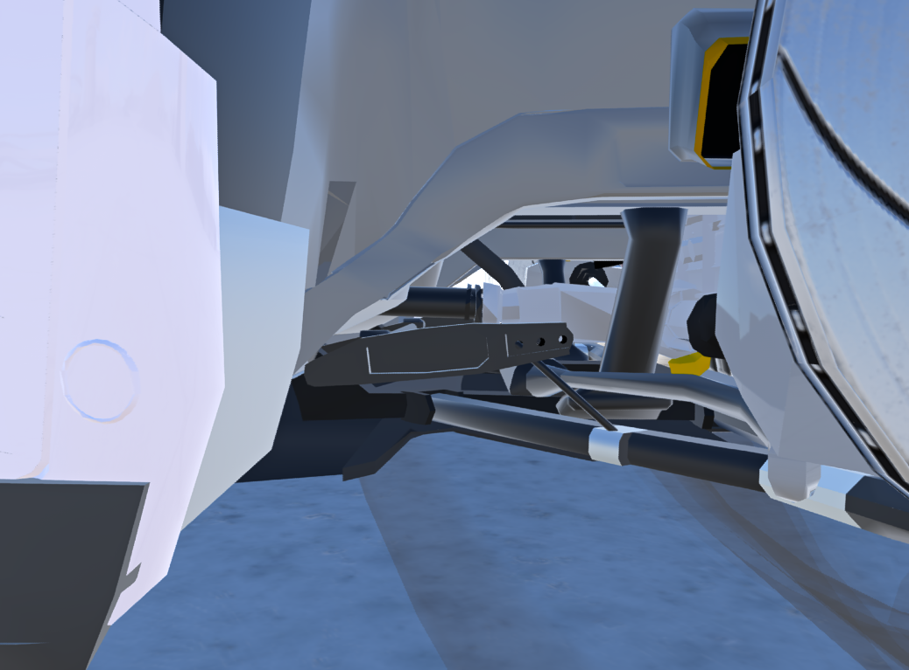
  - **Measuring stiffness:**
  - I used to compare the bars by measuring the Z displacement of the cantilever tip. That only works under limited geometry assumptions.
  - More Z movement does not necessarily mean more twist. Different radii and starting angles can produce different vertical displacements for the same rotation.
  - The new workbook calculates angular movement around the bar's axis from the node positions, then compares it with wheel travel. This also accounts for the fact that the two reference nodes do not necessarily share the same X coordinate.
  - With the springs removed, I measure from the **settled, fully extended position after precompression**, using the wheel-jack debug part, to the bump stops. Spawn coordinates are not a reliable starting point for every setting. The equivalent wheel rate follows **torsional stiffness × angular motion ratio squared**, with the appropriate unit conversion.
  - The new calculations give equivalent rates over the measured interval that are **MORE THAN TWICE the old estimates**. The revised geometry has significantly reduced tarmac body roll in testing.\
    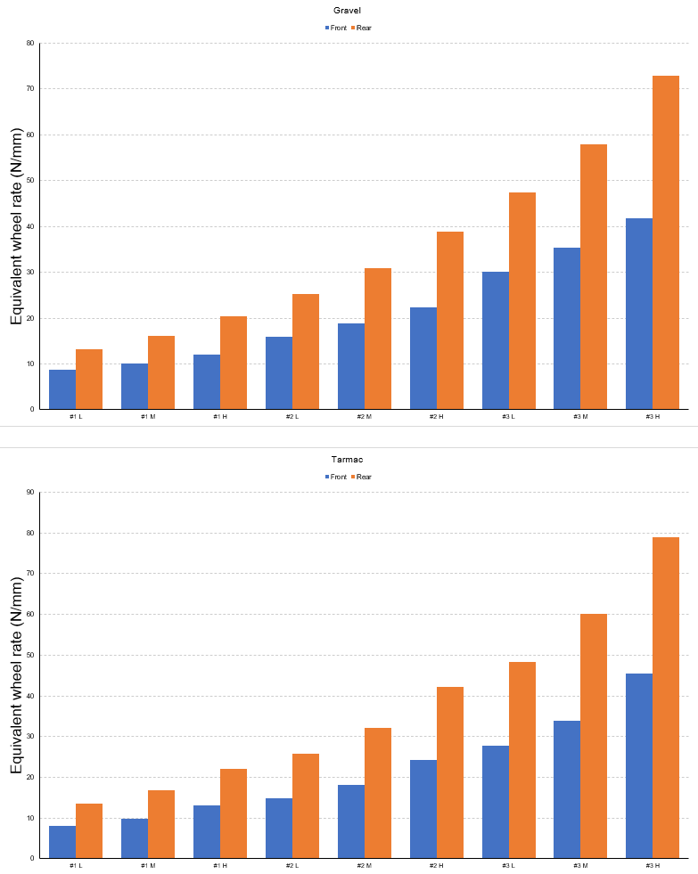

- Restored a triangulated lower ARB pickup in the subframe, since the adjustment no longer moves arb3.

- Removed some beams on the ARB mounting to increase stability.

- Removed the obsolete ARB adjustment beams from the suspension groups.

- **RECALIBRATED THE BRAKE SYSTEM AS A COMPLETE SET**
  - Revised the relationship between master-cylinder bore, pad multiplier, disc size, balance bar and maximum pedal force, instead of adjusting one coefficient in isolation.
  - The three main master cylinders are now **17.8 / 19.7 / 21.5 mm**, with hydraulic multipliers of **1.139 / 0.930 / 0.781**.
  - The pad multipliers are now **A 0.72 / B 0.68 / C 0.65**, giving a meaningful difference between compounds while retaining A > B > C.
  - Following real setup-sheet references, Rally2 and WRC17 tarmac configurations use **#1 front / #2 rear** master cylinders; gravel uses **#1 / #1**.
  - Recalibrated the disc constants so the tarmac braking-strength baseline is retained at the new **90% maximum pedal-force setting**.
  - Adjusted the balance bar range to retain the intended front / rear result.
  - The handbrake calculation now includes its cylinder and lever factors and uses the same selected rear pad multiplier, rather than a separate hidden pad calibration.
  - Updated the brake-balance workbook to match the parts. It has a **3 × 3 front / rear master-cylinder matrix**, selectable hardware and a fixed percentage colour scale.\
    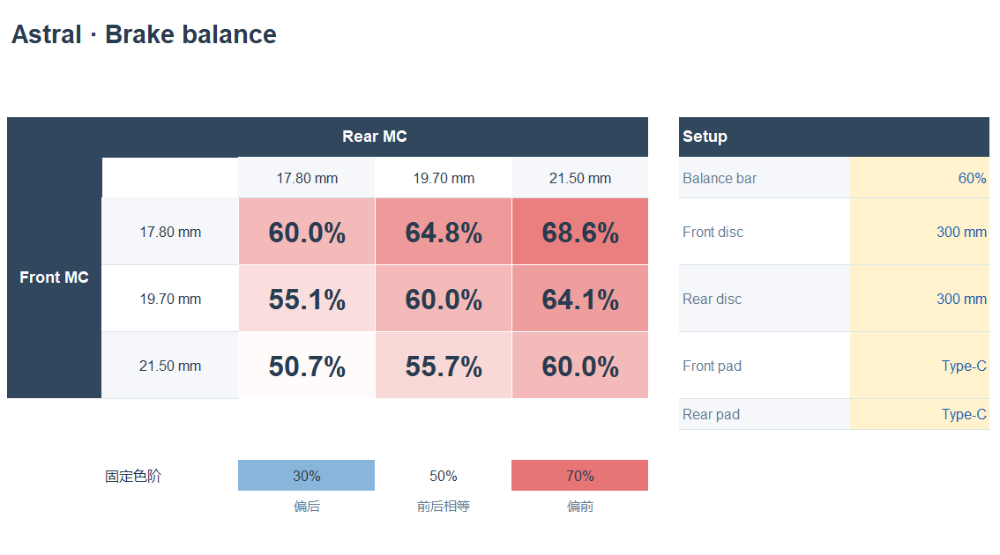

- Reduced damper gas-pressure defaults to **125 PSI**, using the 8 bar specifications in the i20 N Rally2 and Polo GTI R5 references as a guide.

- **RECALIBRATED SPRING LENGTHS AND PLATFORM SETTINGS TO KEEP RIDE HEIGHT CONSISTENT WITH THE NEW WEIGHT AND GAS SUPPORT**

- Increased Rally2 tarmac spring rates by 1.5 N/mm and revised the rear gravel rates and default spring selection.

- Simplified power-steering tuning to a single strength adjustment.

- Reduced FFB strength.

- Fixed various smaller issues.

## Misc

- Fixed outdated default wheel references in the suspension parts and updated RX3 to the current rim and tyre slots.

- **EXPANDED THE PARAMETER WORKBOOKS**
  - Added separate gravel, tarmac and RX damper workbooks, with model catalogs, sweep plots and consistent chart proportions.
  - Updated the ARB workbook to compare front and rear axles in separate gravel and tarmac charts, using the new angular-motion measurements and shared diameter-based stiffness baseline.
  - Updated the differential ramp calculator, brake-balance matrix and throttle-curve calculator to match the implemented parameters.
  - Added the spring / ride-height workbook with free lengths, rates, helper springs, spring colours and the recorded axle-weight / ride-height references.
  - Updated the suspension node / rail calculator and standardized workbook fonts, headers, alternating row colours and editable-input highlighting. Removed unnecessary explanatory text from the working tables.

- **ADDED ENGLISH / SIMPLIFIED CHINESE LOCALIZATION USING THE 0.39 SYSTEM**
  - Adopted the JSON-based localization system used in 0.39, where keys select the corresponding translations.
  - Localized part and slot names, tuning labels and descriptions, configuration names and descriptions, and categories.
  - The two dictionaries currently contain **417 matching entries each**, with reusable name templates for brands, models and prefixes.
  - This also allows surface and event names to translate as part of the configuration name, instead of leaving half of a Chinese menu in English.

- Reviewed the 16 main Rally2 / WRC17 gravel and tarmac configurations individually, covering differential settings, ARBs, damping, brakes, ballast and platform offsets. **THE SETUPS ARE NOT FINAL AND STILL NEED TESTING.**

- Updated older derived configurations where shared parts or renamed variables required it, and removed obsolete saved tuning fields.

- Standardized the underlying WRC17 configuration, info and thumbnail filenames from **wrc+** to **wrc17**, while retaining the intended **WRC+ display name**.

- Added vehicle **subCategory** entries to the info files for a cleaner configuration list.\
  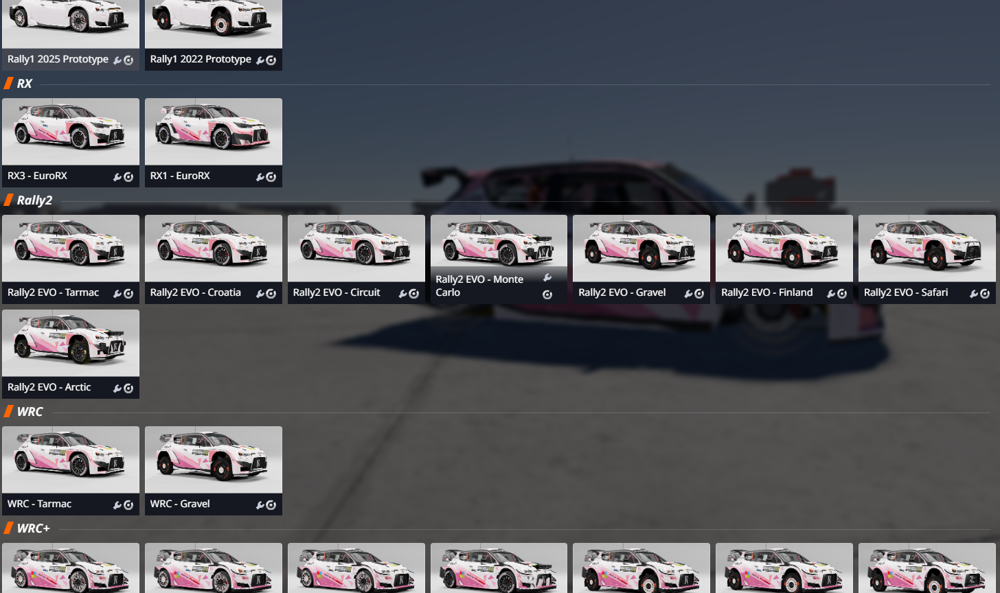

- Renamed and regrouped the Rally1 configurations as **Rally1 2022 Prototype** and **Rally1 2025 Prototype** under **Prototype / Testing**.

- **A BONUS FOR MAKING IT THIS FAR: THE RALLY2 WRC KIT IS PLANNED FOR THE NEXT UPDATE, WITH 10 kg LESS WEIGHT, A NEW FRONT BUMPER, A NEW REAR WING AND A 33 mm RESTRICTOR!**

- Reorganized the repository into the game's vehicle / art / locale paths, migrated parts to the current slot layout, and standardized variable naming and front / rear suffixes.

- Cleaned up outdated part references, duplicate settings and left / right inconsistencies.

## RESERVED FOR THE NEXT UPDATE

- **barA / barG: I HAD AN EXTRA BAR OF BOOST**
  - I mixed up absolute pressure (**barA**) and gauge pressure (**barG**). Absolute pressure includes atmospheric pressure; gauge pressure measures the increase above it. With roughly 1 bar of atmospheric pressure, **2.5 barA is about 1.5 barG**, while **2.5 barG is about 3.5 barA**.
  - BeamNG's turbo wastegate settings use gauge pressure in PSI. My rally settings of 35.8–36.2 PSI therefore target roughly **2.5 barG**, putting them about **1 bar above the intended 2.5 barA**. I had fitted the engine and turbo curves around that higher pressure, which explains why the final power figures could still look right.
  - The engine and turbo curves have already been fitted to these pressure settings, so the discrepancy has no significant effect on the intended in-game performance. I am keeping the current pressure for this release; correcting it and recalculating the curves will be the first job for the next update.

- The aerodynamics revision and final Rally2 WRC Kit aero / weight specification.

- Further configuration fine-tuning beyond the revisions described above.

- **Possible Rally1 hybrid implementation.** The i20 N Rally1 reference and FIA technical guide has helped clarify the rules and control maps:
  - Choose from 3 e-boost maps and 3 e-regen maps before each stage. The 5 e-kit positions control hybrid behaviour in road / stage modes.
  - Regen activates when front brake pressure exceeds 5 bar and throttle input is below 30%.
  - Boost becomes available after recovering 30 kJ.
  - Recovering 3 kJ in the same cycle cancels the current boost allowance.
  - Maximum regen power is 30 kW.
  - Maximum boost power is 100 kW.
  - Officials set the maximum deployment allowance for each stage. For example a 300 kJ allowance lasts 3s at 100 kW, or 6s at 50 kW.
  - Above 80% state of charge (SOC), regen is followed by forced boost even if the recovered energy has not reached 30 kJ.
  - **This looks feasible with a Lua controller similar to N2O.**

- Dashboard, engine and electronics development, including the planned eWastegate / ALS work.

- Brake thermodynamics.
