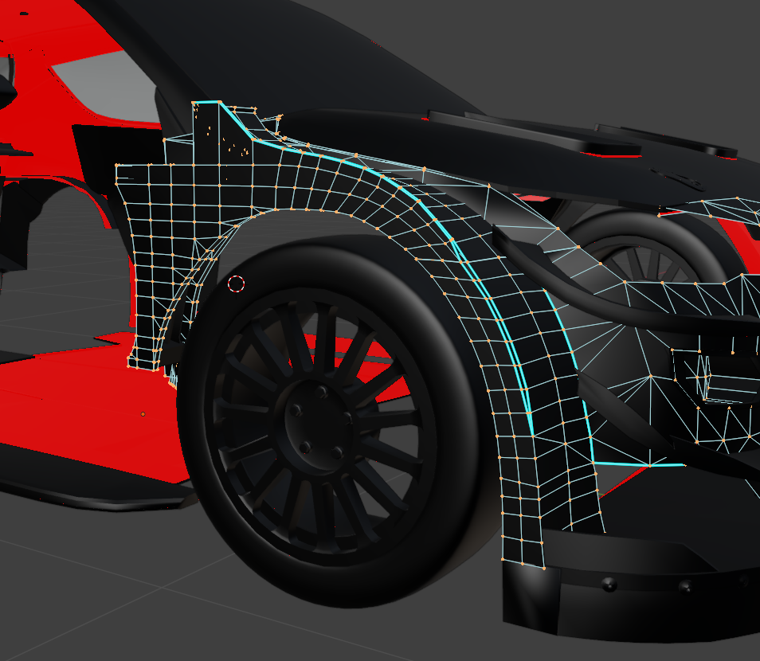
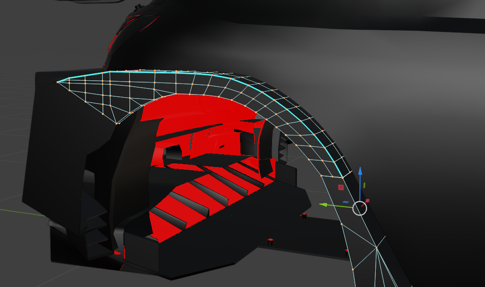
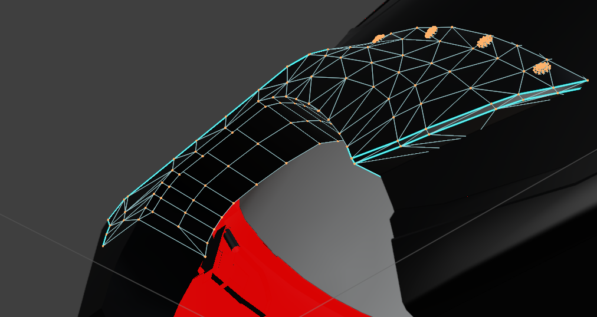
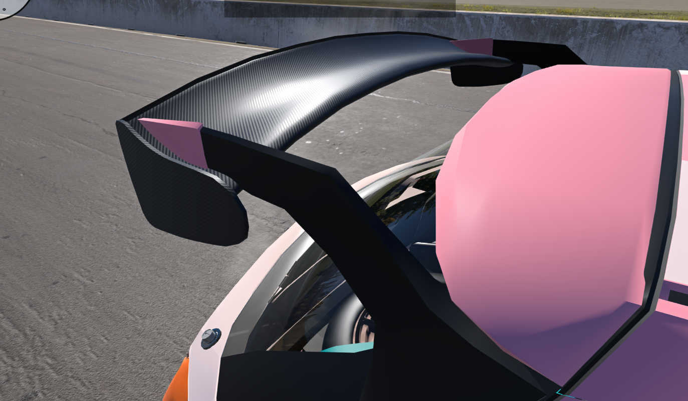

# Qlourie Astral R — 26.11.11

**English** | [简体中文](./26.11.11.zh-CN.md)

**MY LAPTOP IS IN THE HELL AND NO LONGER FIXABLE SO THE DEVELOPMENT WILL HALT UNTILL I GET A NEW POWERFUL PC.**

This update continues the work on the body meshes and chassis setups. I revised the fenders, rear wings and carbon-fibre materials, retuned the gravel and tarmac tyres, and changed the ARB stiffness and HSC Calculations. Several presets have also been updated, along with fixes for the sound issues after the 0.40 hotfix.

## Chassis and bodywork

- HUGELY reworked the **fender meshes and topology**.
  - The WRC17 fenders and other meshes received a substantial rework to clean up absolutely mess generated by Automation.\
    \
    
  - Added more subdivisions on curves so the fenders now have higher definition.
  - Cleaned up topology to delete all non-continuous faces and duplicating faces, making all fender meshes either open or half-open.\
    
  - Reworked on RX1 rear fender mesh.

- HUGELY Cleaned up the unused UV maps so the mesh is **HALF** the size now and loads faster than before.

- **AS STATED BEFORE, NO PLANS ON SKINS DUE TO THE POLYFLOWS ARE BAD AND UV UNWRAP IS NOT IDEAL.**

- Adjusted the carbon material's UV, clear coat and roughness.

- Rebuilt the Rally2 rear wing's mounting structure by **removing swan neck nodes** and moving supports closer to the edge.\
  

- Revised the support structures, deformation limits and breaking thresholds on the Rally2, WRC Kit, WRC16, WRC17, Rally1 and RX rear wings.

- Removed the old tailgate support mesh references and cleaned up the corresponding node groups.

- Reduced some of the mudflap structural damping and adjusted the rear mudflap's auxiliary damping.

## Engine and transmission

- Addressed the sound issues after the 0.40 hotfix, rebalanced engine, exhaust and gearbox levels.

- Reduced the engine and exhaust main gains, revised the high-frequency EQ and adjusted the cabin sound filtering.

- Increased the gear-whine coefficients on both five- and six-speed sequential gearboxes, including revised whine levels in the six-speed's higher gears.

## Suspension

- Further increased the torsional stiffness of all three front and rear ARBs by about **23.5%**.

- Recalibrated damper valving HSC calculations.
  - HSC now calculates without the base damping offset, range starts from 0.
  - **Improved** HSC tuning range to fit wider applications.
  -  The HSC knee is **0.05 m/s** lower on tarmac Type-A valving and **0.03 m/s** lower on RX Type-A valving.

- Revised the auxiliary damping around the strut rails and ball joints.

- Further retuned tyres.
  - Referenced again from IRL stage onboards like 2018 Wales the Great Orme, and various Finland/Estonia stages, gravel tyres should be **even more gripper than before.**
  - Sliding friction **rises from 1.10 to 1.15** on the **GX** gravel tyre and from 1.10 to 1.14 on the **G** gravel tyre, makes sliding even more controllable.
  - `TreadCoef` and load sensitivity retuned on **GX and G** gravel tyres.
  - Load sensitivity adjusted on **FX and F** tarmac tyres.
  - `TreadCoef` and beam properties retuned on **ALP** tarmac tyre.
  - Sliding friction **rises from 1.08 to 1.10** on the **Flux** RX tyres.

- Reduced the `brakeSpring` parameter on several brake assemblies to address braking stability.

- Increased the handbrake strength to a default of 0.74 instead of 0.56, adjusted tuning range.

- Reduced the default max pedal force to 0.85.

## Misc

- Revised multiple profiles by tuning the ARBs, ride height, compression and rebound.

- Rally2 and WRC17 monte-carlo profiles get revised brake-pad selections on both axles, softer front ARBs, and revised mounting positions, rear compression and differential preload.

- Updated the default vehicle image and configuration thumbnails.

- Updated the ARB stiffness workbook and the RAx0, RAx5 and RAx8 damping-curve workbooks.
