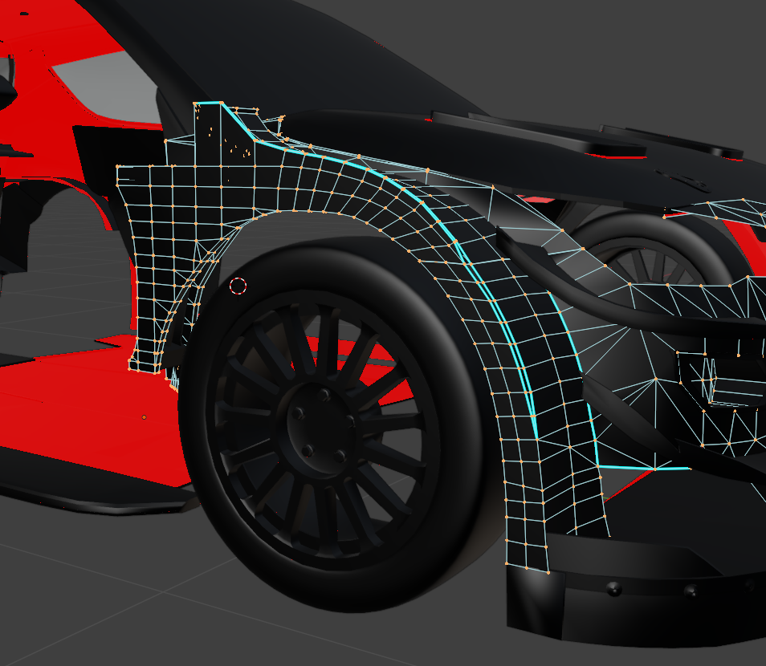
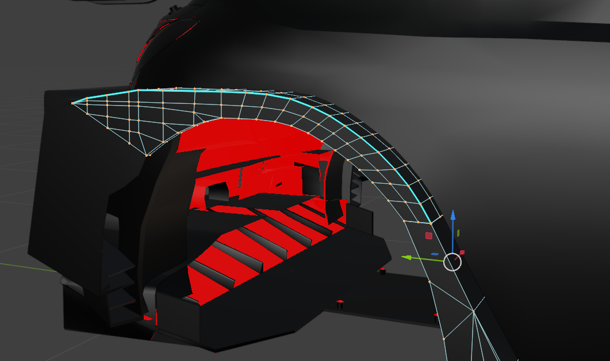
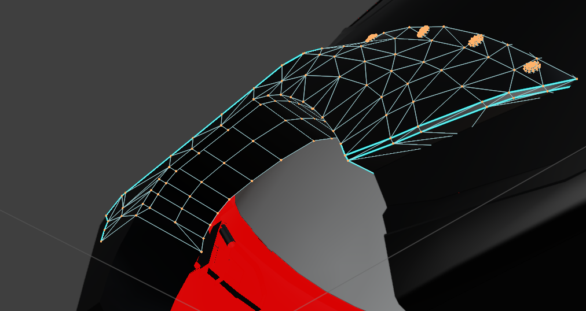
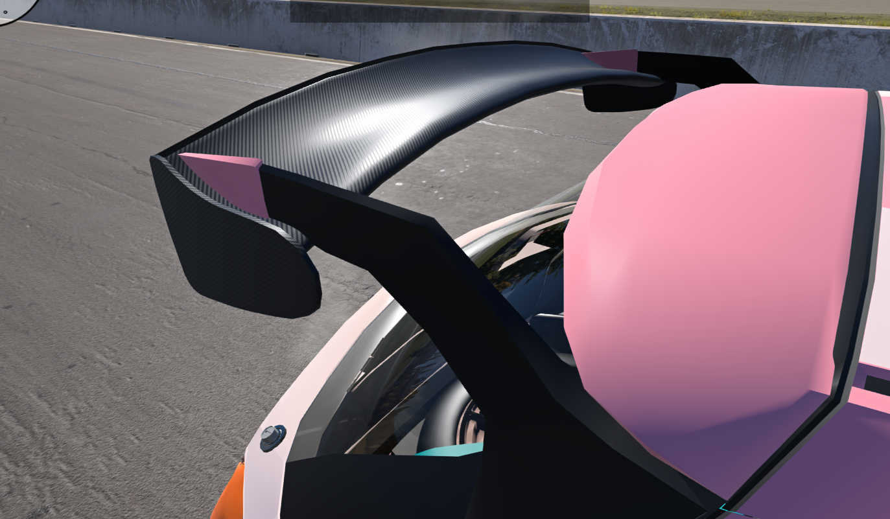

# Qlourie Astral R — 26.11.11

[English](./26.11.11.en-US.md) | **简体中文**

**我的笔记本彻底死球而且没法修了。所以在我换新电脑之前，项目开发将暂时停止。**

本次更新继续对车身模型和底盘设定进行调整。我重新制作了翼子板、修改了尾翼结构和碳纤维材质，进一步调整了砂石与柏油轮胎的抓地特性，并修改了防倾杆刚度和高速压缩阻尼（HSC）的计算公式。此外，还更新了多套预设配置，并修复了 BeamNG 0.40 热修复更新后出现的声音问题。

## 底盘与车身

- **大幅重做了翼子板模型和拓扑结构。**
  - 对 WRC17 翼子板及其他模型进行了大规模重做，清理了 Automation 生成的一团乱麻般的拓扑结构。\
    \
    
  - 增加了曲面区域的细分数量，提高了翼子板的模型精度。
  - 清理了所有不连续面和重复面，使所有翼子板模型都成为开放或半开放的结构。\
    
  - 重新制作了 RX1 的后翼子板模型。

- **大幅清理了未使用的 UV 映射，使模型文件大小缩减至原来的一半，加载速度也比以前更快。**

- **和之前说过的一样，由于目前模型的布线不理想，UV 展开也存在问题，暂时没有制作车辆涂装的计划。**

- 调整了碳纤维材质的 UV、清漆强度和粗糙度。

- **重做了 Rally2 尾翼的安装结构，移除了天鹅颈支架节点，并将支撑结构向尾翼两端移动。**\
  

- 修改了 Rally2、WRC Kit、WRC16、WRC17、Rally1 和 RX 尾翼的支撑结构、变形极限和断裂阈值。

- 移除了尾门上旧的支撑模型引用，并清理了对应的节点分组。

- 降低了部分挡泥板结构的阻尼，并调整了后挡泥板的辅助阻尼。

## 发动机与传动系统

- 修复了 BeamNG 0.40 热修复更新后的声音问题，重新平衡了发动机、排气和变速箱的音量。

- 降低了发动机与排气声音的主增益，重新调整了高频均衡器，并修改了座舱内的声音滤波。

- 提高了五挡和六挡序列式变速箱的齿轮啸叫系数，同时重新调整了六挡变速箱高挡位的啸叫音量。

## 悬挂系统

- **进一步提高了前后三档防倾杆的扭转刚度，增幅约为 23.5%。**

- **重新标定了减振器高速压缩阻尼（HSC）的计算公式。**
  - HSC 现在不再包含基础阻尼偏移量，调节范围从 0 开始。
  - **改善了 HSC 的可调范围**，使其能够适应更广泛的使用场景。
  - 柏油 Type-A 阀系的 HSC 拐点降低了 **0.05 m/s**，RX Type-A 阀系降低了 **0.03 m/s**。

- 调整了减振支柱导轨和球头连接附近的辅助阻尼。

- **进一步调整了轮胎。**
  - 再次参考了真实拉力赛的车载录像，包括 2018 年威尔士 Great Orme 赛段，以及芬兰和爱沙尼亚的多个赛段。我认为砂石轮胎的**抓地力还应该比之前更强**。
  - **GX** 砂石胎的滑动摩擦系数从 **1.10 提高至 1.15**，**G** 砂石胎从 **1.10 提高至 1.14**，使车辆在滑动状态下更加容易控制。
  - 重新调整了 **GX 和 G** 砂石胎的 TreadCoef 和载荷敏感性。
  - 调整了 **FX 和 F** 柏油胎的载荷敏感性。
  - 重新调整了 **ALP** 柏油胎的 TreadCoef 和结构梁参数。
  - **Flux** RX 轮胎的滑动摩擦系数从 **1.08 提高至 1.10**。

- 降低了多套制动系统的 `brakeSpring` 参数，以改善制动稳定性。

- 增强了手刹力度，将默认参数从 **0.56 提高至 0.74**，同时调整了可调范围。

- 将最大踏板力的默认参数降低至 **0.85**。

## 其他

- 重新调整了多套预设配置，包括防倾杆、车身高度、压缩阻尼和回弹阻尼。

- Rally2 和 WRC17 的蒙特卡洛预设更新了前后刹车片的选择，采用更软的前防倾杆，并调整了安装位置、后轴压缩阻尼和差速器预载。

- 更新了默认车辆图片和各预设配置的缩略图。

- 更新了防倾杆刚度工作簿，以及 RAx0、RAx5 和 RAx8 三份减振器阻尼曲线工作簿。
