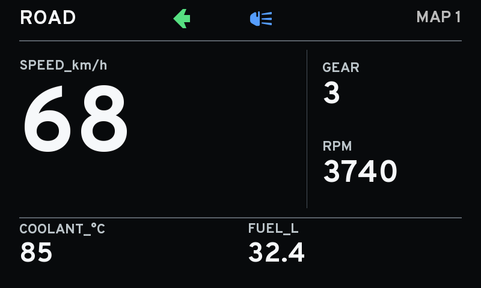
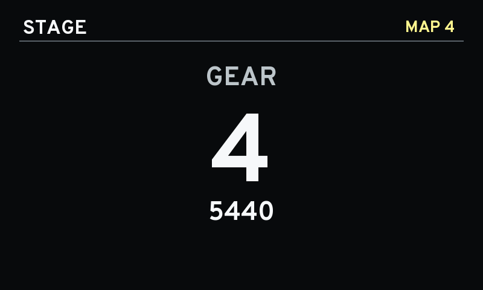
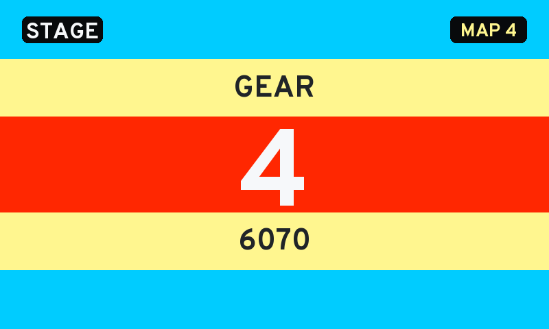
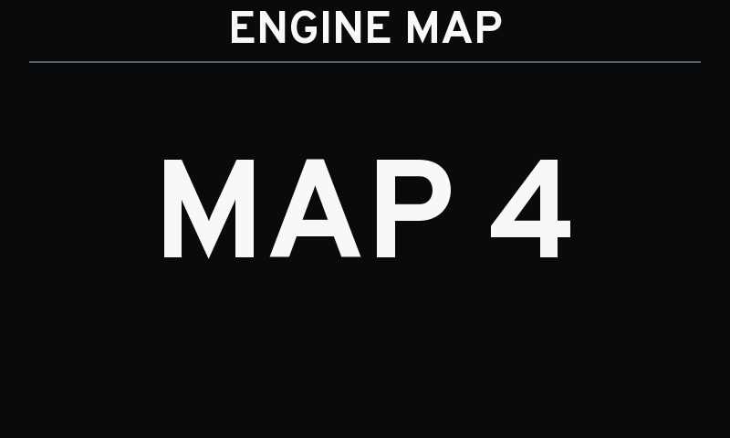
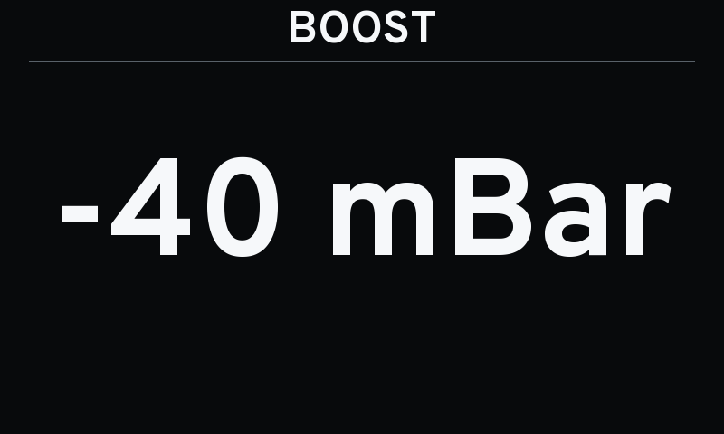
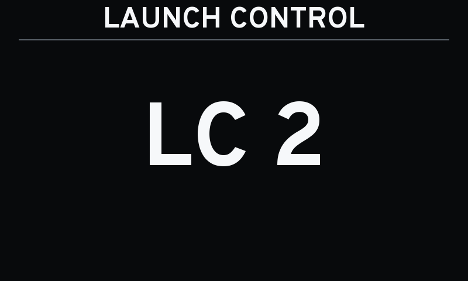
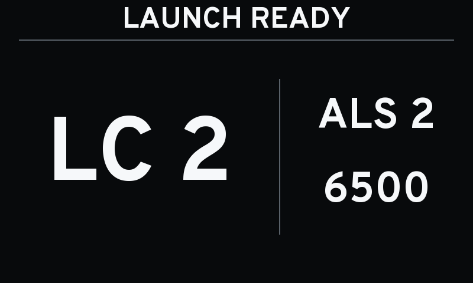
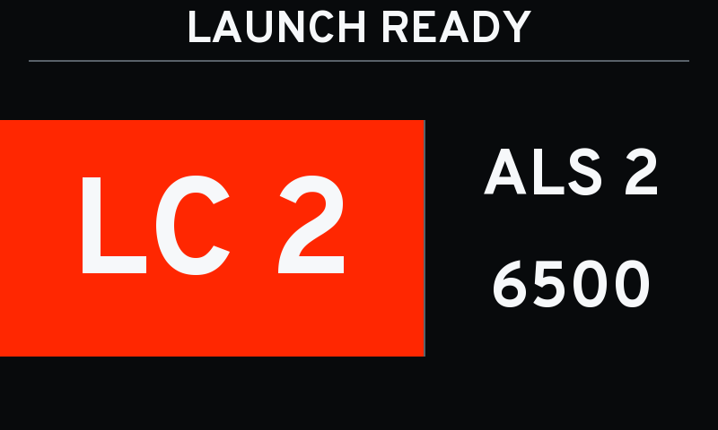
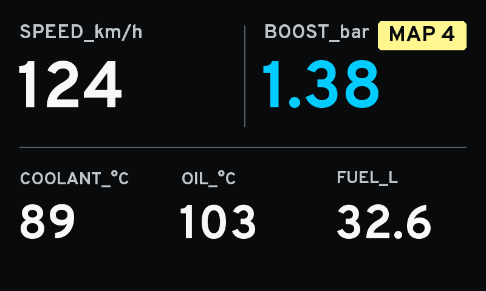
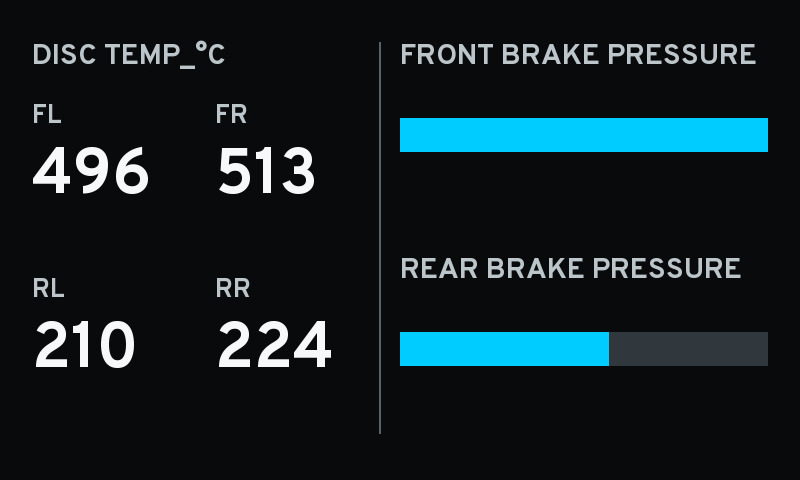

# Qlourie Astral R — 下一版更新草稿

[English](./draft.en-US.md) | **简体中文**

换了新电脑，终于有机会回来收拾 Automation 留下的仪表台了。这版也把拉力车的增压重新算了一遍。悬挂上花时间最多的是高速压缩阻尼，尤其是芬兰那些飞跳落地的地方。

## 底盘与车身

- **重做了整个仪表台。** 原来 Automation 导出的模型从左到右都是乱的布线，这次重新做了一遍。中央控制台也单独拆了出来，用自己的柔性车身网格挂在车架上。

- 重做了前挡风玻璃下沿，配上从《EA SPORTS WRC》适配过来的雨刮器。

- 把车载摄像机的两块模型网格从车身节点改挂到前车架节点，保留防滚架节点，减少回放时模型的抖动。

- 给所有前唇模型重新布了线，修好了原来的网格拓扑。

- 修好了装上带手部动画的车手后整车会轻 5 kg 的问题。这套模型的车手参考节点现在是 12 kg。

- 调低了前保险杠和车后部刹车风道的冷却系数。以 WRC17 为例，两种前风道从 1.48 和 1.40 降到 1.25 和 1.15，封板为 1.00。

### 空气动力

- **重新调了保险杠和尾翼，增加了各车的下压力和阻力。** WRC17 的前保险杠和大风刃现在能提供更多前部下压力。WRC17 和 Rally1 都改了后扩散面节点的位置，Rally1 后护板上原先被注释掉的两个气动三角面也恢复了。挡泥板的阻力也加了一些。

- Rally1 尾翼的小翼原先有一个过大的斜面，横风一吹就兜风。这次重新划了三角面，再用 90 km/h 的纯侧风逐车拆装尾翼。装上尾翼后，Rally1 的侧向力增加 137 N，WRC17 增加 115 N。同样条件下，Rally2 是 22 N，WRC16 是 38 N，WRC套件是 37 N，RX1 是 36 N。另外删掉了 WRC16 和 RX1 尾翼上的鳍片模型。

下面是 180 km/h 正迎风的整车实测。前两列用拉力车的柏油配置，RX1 用自己的比赛配置。

| 车型 | 阻力（N） | 下压力（N） | 砂石阻力（N） | 砂石下压力（N） |
|---|---:|---:|---:|---:|
| WRC17 | 2443 | 3909 | 2452 | 3610 |
| Rally1 | 2006 | 3318 | 1990 | 2909 |
| Rally2 | 1369 | 1769 | 1353 | 1256 |
| Rally2 WRC套件 | 1475 | 2049 | — | — |
| RX1 | 1623 | 2211 | — | — |

柏油上，完整的 WRC套件比普通 Rally2 **多了 280 N 下压力，阻力增加 106 N**。尾翼也单独拆装测了一遍。WRC套件的尾翼贡献 704 N 下压力，RX1 双层尾翼是 768 N，WRC16 是 811 N。WRC套件和 WRC16 的尾翼都装在同一辆 Rally2 上测。

### 驾驶舱仪表

- 重新建模了仪表总成，修复了仪表网格的布线。21 个拉力预设统一使用 **TypeA**（`Astral_gauge_rally`），沿用 WRC17 的支架。RX1 和 RX3 使用 **TypeB**（`Astral_gauge_rx`），带车内后视镜、附加刹车灯和熄火警示。两套仪表共用 800 × 480 的 Skia 屏幕，换挡灯读取各车 ECU 的标定。

- Road 页面放大显示车速，同时显示挡位、发动机转速、水温和剩余油量。顶部的绿色左右箭头随车外转向灯闪烁，近光指示为绿色，远光指示为蓝色。Stage 页面把挡位和转速放在中央。青、黄、红三色灯带与实体换挡灯共用各挡亮灯阈值和闪烁信号。

- 领航员屏默认显示车速（km/h 或 mph）、涡轮表压（bar）、水温、油温和剩余油量，并用当前 MAP 的颜色标出编号。绑定“循环切换领航员仪表页”即可在动力页和制动页之间切换。车手调整 MAP、BOOST 或准备发车时，领航员仍能查看自己选的页面。

- 制动页左侧显示四个刹车盘的表面温度（°C），右侧两条压力条显示前、后制动回路的相对压力。两条共用“满踏板时的前刹压力 = 100%”这一刻度。后刹读数随平衡杆和前后主缸的配比变化。以 Rally2 柏油均衡预设为例，踩到底时前条满格，后条约为 57%。

- 切换 LC1、LC2 或 LC3 时，主屏会全屏显示 **LAUNCH CONTROL** 和新档位，持续 1.6 秒，与 MAP 和 BOOST 调整页一致。按下 Start 后，主屏切到 **LAUNCH READY**，显示所选预设、ALS 档位和发车限转。程序执行期间，达到发车灯转速时左侧预设区域变红。

展开驾驶舱仪表预览

以下 800 × 480 预览使用示例读数。主屏数字最高以 30 Hz 刷新，Stage 页以最高 60 Hz 采样换挡灯，领航员两页的刷新上限都是 15 Hz。

| 仪表预览 |   |
|---|---|
|  1. Road 行驶页 |  2. Stage，换挡灯熄灭 |
|  3. Stage，三色灯带点亮 |  4. 发动机 MAP 选择 |
|  5. BOOST 调整 |  6. 发车预设选择 |
|  7. LAUNCH READY 待命 |  8. LAUNCH READY 发车灯点亮 |
|  9. 领航员车速和动力读数 |  10. 领航员制动页 |

## 发动机与传动系统

- **把拉力车的增压调回了正确的数值。** 我之前把 2.5 bar 绝压看成了增压表上的 2.5 bar。现在涡轮 A 和 B 的比赛目标都是 **1.5 bar 表压（21.75 psi）**。涡轮轴转到约 162,500 rpm 时，压力曲线达到这个数，之后还能继续往上。实际增压由电子废气旁通阀控制，两款涡轮的升压速率参数都是 50 psi/s。
  - 把 Rally2 原先在 ECU 里补的进气扭矩并进了共用的 1.6 升基础发动机，再重新拟合 ECU 和限流器，保留之前各车的动力区间。从这次游戏导出看，32 mm 的 Rally2 峰值是 **290 PS**，同一套发动机和 ECU 换上 WRC套件的 33 mm 限流器是 **307 PS**。
  - 顺平了自然吸气曲线在 2000～2500 rpm 的凹陷，以及拉力 ECU 在 800～850 rpm 的扭矩台阶。RX 涡轮沿用自己的 55.5 psi 比赛目标。

- **WRC16 的 Road 限转从 5500 提到 6500 rpm，Stage 从 7650 提到 8500 rpm。** Stage 限转随缸体变化，WRC 缸体为 8500 rpm，Rally2 缸体为 7500 rpm，WRC 套件也沿用 Rally2 缸体。两款基础发动机统一管理断油时长和转速回落值。
  - WRC16 和 Rally2 WRC Kit 共用一套 33 mm 限流器参数。WRC16 的高转修正写在自己 ECU 的 `torqueModIntake` 里。峰值扭矩约 411 Nm，出现在 4450 rpm 左右，峰值功率在 6000 rpm 左右。增压扭矩在 7500 rpm 时为 271 Nm，8000 rpm 时为 238 Nm，到 8500 rpm 断油前降至 199 Nm。Kit 保留原有的功率和扭矩曲线，一直到 7500 rpm 断油。
  - 两套齿比的六挡换挡灯都在 8500 rpm 闪烁。三档发车转速各自可在 4500～8500 rpm 之间调节，每格 100 rpm。

- **所有车型默认生成在 MAP 1（Road）。** 拉力车型可以在调校菜单的「生成时的发动机 MAP」中另选起始档位。行驶中按 `Ctrl+Q` 或点转速表旁的图标切到下一张 MAP，也可以给方向盘旋钮绑定每一档。
  - Road 带油升挡时断火 150 ms，收油、刹车和升挡时都关闭排气放炮。切回 Stage 后，六速序列箱的升挡断火恢复到 52 ms，五速恢复到 58 ms。
  - 街机模式会按 Road 限转降低高负荷升降挡点，避免全油门顶着限转器不升挡。切回 Stage 即恢复比赛换挡点。五速和六速都沿用 Vivace 拉力序列箱的自动离合起步标定。

**拉力车型发动机 MAP**

| MAP | 模式 | 油门曲线 | ALS | 适用场景 |
|---|---|---|---|---|
| 1 | Road | Progressive | 关闭 | 行驶路段 |
| 2 | Stage Soft | Subtle Linear | 关闭 | 冰雪或极低抓地赛段 |
| 3 | Stage Low | Subtle Linear | 柔和（14%） | 松散或湿滑砂石 |
| 4 | Stage Med | Subtle Linear | 中等（30%） | 压实砂石或湿柏油 |
| 5 | Stage High | Subtle Linear | 激进（100%） | 干柏油等高抓地赛段 |

ALS 百分比表示该档可用的补能功率。

**RX1 与 RX3 发动机 MAP**

| MAP | 模式 | 油门曲线 | ALS | 适用场景 |
|---|---|---|---|---|
| 1 | Road | Progressive | RX1 关闭 / RX3 未配备 | 维修区、转场 |
| 2 | Stage Low | Progressive | RX1 柔和，45,000 rpm / RX3 未配备 | 松散路面或低抓地起步 |
| 3 | Stage Med | Subtle Linear | RX1 中等，65,000 rpm / RX3 未配备 | 混合路面比赛 |
| 4 | Stage High | Subtle Linear | RX1 激进，85,000 rpm / RX3 未配备 | 高抓地比赛路段（RX1） |

RX1 的 rpm 是收油时的涡轮目标轴速。RX3 的 Stage Med 和 Stage High 使用相同的油门曲线。

### 电子废气旁通阀（eWasteGate）

拉力车 ECU 按发动机转速查两条增压曲线，一条对应完全收油，一条对应全负荷。驾驶员踩下油门时，ECU 按当前 MAP 映射后的油门开度，在两条曲线之间取值。例如，映射后的油门开度为 50% 时，目标已经从收油值向全负荷值走了 65%。下文的压力均为表压。

| 拉力车型及涡轮 | 完全收油时，目标保持零表压的最高转速 | 全油门时，首次请求满压的转速 |
|---|---:|---:|
| WRC17（Turbo A） | 4800 rpm | 5500 rpm |
| Rally1 2022（Turbo A） | 5500 rpm | 6000 rpm |
| Rally1 2025（Turbo A） | 5200 rpm | 5850 rpm |
| Rally2、Rally2 WRC 套件、WRC16（Turbo B） | 4250 rpm | 5100 rpm |

- **刹车降挡。** 以 WRC17 的 Stage 为例，BOOST 减量为零，全松油降挡使发动机从 6000 rpm 升到 6500 rpm 时，目标表压会从约 0.45 bar 升至 0.87 bar。刹车踏板没有单独的触发门槛。左脚刹车时，右脚保留的油门仍参与计算。涡轮轴加速需要时间，因此增压表和啸叫音调都可能落后于目标。
- **BOOST 旋钮。** 行驶中可从目标扣除 0、20、40 或 80 mbar。Turbo A 和 B 在 Stage 全负荷下的额定目标约为 1.50 bar，选 −80 mbar 后约为 1.42 bar。Road 请求零表压，切回 Stage 后沿用原先的旋钮位置。即便在关闭 ALS 的 Stage Soft，增压控制仍然工作。
- **原地空轰。** 停车挂空挡或完全踩下离合时，常态增压目标最高为 1.5 psi（约 0.10 bar）。挂挡后逐渐接合离合，或车速上升，都会逐步解除这个限制。发车程序开始执行后，ECU 暂时跳过空轰限制和比赛 BOOST 减量，仍按同一套油门和转速曲线建压。

RX1 的比赛涡轮额定表压为 55.5 psi（约 3.83 bar）。其常态目标按油门开度和 BOOST 减量计算。收油保转期间，废气旁通阀会为 ALS 的目标轴速保留相应的增压余量，上限仍由驾驶员选定的 BOOST 减量决定。

### 偏时点火（dynamicAntiLag）

在拉力车上，废气旁通阀控制器根据目标表压和所装涡轮的特性，算出需要的涡轮轴速。ALS 比较目标轴速和实际轴速，按缺口向涡轮补能。三个 ALS 档位共用目标，Stage Low 最多调用 14% 的补能功率，Stage Med 为 30%，Stage High 为 100%。实际轴速追上目标后，补能请求随之降低。Stage Soft 关闭 ALS，由发动机排气自行带动涡轮。

**四挡收油后多久能恢复 1 bar？** 此前用芬兰预设测试时，四挡收油轻刹 1.83 秒，然后重新踩满油门，以 60 Hz 记录实际表压。下表从重新踩满的那一刻开始计时，到表压恢复至 1.0 bar 为止。

| 芬兰预设 | MAP 2 / 关闭 | MAP 3 / 柔和 | MAP 4 / 中等 | MAP 5 / 激进 |
|---|---:|---:|---:|---:|
| WRC17 | 0.65 秒 | 0.45 秒 | 0.37 秒 | 0.22 秒 |
| Rally2 | 0.63 秒 | 0.45 秒 | 0.37 秒 | 0.20 秒 |

**排气放炮。** 赛段行驶中，瞬时和持续放炮系数随实际补能量放大，零补能时为 ×1，满补能时为 ×20。WRC17 和 Rally2 的瞬时基础系数为 4.2，与原厂 Vivace NGRC1 一致，持续基础系数为 3。在 Low、Med、High 各自满补能时，瞬时系数分别为 15.37 / 28.14 / 84，持续系数为 10.98 / 20.10 / 60。WRC16 和两款 Rally1 的瞬时基础系数为 60，在 High 下最高可达 1200。Turbo A 和 B 还将持续放炮的音量乘以 1.5。发车时的怠速点火逻辑见下节。

**RX 的区别。** RX1 在怠速以上给过至少 5% 油门，再收到 2% 或以下，会按所选档位保转。三档上限分别为 45,000、65,000 和 85,000 rpm，同时受收油瞬间实际轴速限制。每次收油最多维持 10 秒，发动机接近怠速时逐渐退出。发车程序执行且 ALS 开启时，RX1 单独使用 135,100 rpm 的涡轮轴速目标。自然吸气的 RX3 使用发车限转和限扭，没有涡轮和 ALS。

### 发车控制（launchControl）

每个整车预设分别保存 LC1、LC2、LC3 的发车转速和扭矩上限。调校菜单里，转速每格 100 rpm，扭矩上限为发动机峰值扭矩的 50%～100%，每格 5 个百分点。以芬兰预设为例，WRC17 三档分别为 6100 / 6500 / 7000 rpm，Rally2 为 5900 / 6200 / 6600 rpm，两车三档均使用 100% 扭矩。LC 预设决定限转和限扭，发动机 MAP 决定可用的 ALS 强度。

1. **选档并待命。** 点 LC 图标或用绑定的旋钮、按键选档，主屏会短暂全屏显示 **LAUNCH CONTROL** 和所选预设。在 Stage 下，车速不超过 1.8 km/h 时，按“激活或取消发车控制”。按钮变红，主屏进入 **LAUNCH READY**，显示所选发车转速上限。等待手刹时，发动机仍用常态限转、限扭，ALS 补能为零。
2. **手刹拉过 60%，踩油门建压。** 如果按发车键时手刹已经超过 60%，程序立即执行。此时发车扭矩上限生效，发动机达到预设转速才开始限转。拉力车开启 ALS 后，执行发车程序时即便松油怠速也可以听到放炮，此时涡轮补能为零。踩油门提高增压目标后，当前 MAP 的 ALS 才按轴速差补能。ALS 关闭时靠排气建压。
3. **松手刹起步。** 手刹回到 60% 或以下，立即解除发车限转、限扭和发车 ALS。按钮保持红色，主屏仍显示 **LAUNCH READY**。车速未到 10 km/h 时，再拉过 60% 即可重新执行同一预设。达到 10 km/h 后自动退出，再按一次发车键或切到 Road 也会完全退出。待命期间想更换 LC 预设，先取消再选。

### 变速箱与声音

- 略微调长了 Rally1 五挡 A 组和 WRC17 六挡 B 组齿比。比赛飞轮的附加转动惯量从 **0.0200 增加到 0.0265 kg·m²**，共用 1.6 升发动机的基础发动机制动扭矩从 35 提到 40 N·m。

- 按新导出的全负荷曲线、实车齿比和新飞轮重算了拉力车的换挡灯。每一挡都按相同车速比较，看看留在当前挡和升一挡哪个加速更快。Rally2 WRC套件仍由 Rally2 ECU 单独调用 33 mm 的换挡灯标定。
  - WRC16 的 A 组在 6290 rpm 提示一升二，B 组在 6380 rpm。WRC套件的 A 组四次升挡分别在 6440、6560、6500 和 6350 rpm 闪灯。
  - WRC16 的两套齿比共用 Type-A 的全油门自动升挡点，Rally2 WRC 套件使用自己的 33 mm 标定。空挡在 3000 rpm 闪灯，最高挡在各车型的限转点闪灯。

- 发动机音量提高了 3 dB，重调了进排气均衡。三款涡轮的轴速啸叫音量参数统一为 0.025。五挡和六挡序列式变速箱的直齿啸叫也稍微轻了一些。

- 重新调了 RX3 的第二套油门图，油门工作簿里的曲线也同步了。另外修好了街机换挡模式下倒车给油的问题。

## 悬挂系统

- 减振器原来的 A 型阀系改叫**线性活塞**，B 型改叫**递减型活塞**。我试过让两种活塞互换阀片，结果递减型装上硬阀片，曲线也能调得跟线性活塞差不多。最后还是让每种活塞自带一套阀片，选活塞就行。

- **线性活塞**拧紧高速压缩阻尼（HSC）时，第二个拐点会提前，过了拐点，阻尼力也涨得更快。**递减型活塞**调的是第一个拐点，这次把它的移动范围扩大了一倍。柏油、砂石和 RX 的递减型活塞调到中档，都是 26.11.11 的原曲线。
  - 线性活塞从最软拧到最硬，柏油的第二个拐点从 0.54 提前到 0.28 m/s，砂石从 0.76 提前到 0.44 m/s。硬档的支撑来得更早，到了飞跳落地时的高轴速，软硬两端的阻尼力差距反而收窄了。

- 拿柏油线性活塞来说，低速压缩固定在 −12c，轴速 0.5 m/s 时把高速压缩从最软拧到最硬，单支减振器多出 660 N，26.11.11 是 760 N。到了 2.0 m/s，最软到最硬的差距从 6760 N 收到 3408 N。砂石在 1.0 m/s 时，软硬两端的差距从 1520 N 收到 1296 N。RX 线性活塞的中档还是原来的曲线。

- 这次开芬兰预设，高速飞跳落地感觉更顺了。拿最终调好的两份芬兰配置分别跟 26.11.11 比，轴速 1.0 m/s 时，Rally2 每支前减振器的基础压缩力少了 118 N，WRC17 少了 62 N。到了 2.0 m/s，差距分别拉大到 1081 N 和 707 N。这几个数是按对应轴速从阻尼曲线算出来的。

- 回弹旋钮对 LRS 阻尼倍率的调节幅度从中档两侧的 ±0.05 扩大到 ±0.15。前后液压回弹限位也调软了，WRC17 柏油用 2000 N·s/m，WRC17 砂石、Rally1 砂石和 RX1 用 1000 N·s/m。

- 微调了 Rally2、WRC17 和 Rally1 悬挂几何里的外倾和前束基准偏移。

- 提高了 Rally2 柏油前减振器（RA60）左右两侧弹簧座的滑轨约束刚度。也加强了 Rally2、WRC17、Rally1 和 RX 前后减振支柱的导向约束。

- 重新调了几款轮胎。
  - **GX 和 G 砂石胎**的胎面系数从 0.88 提到 0.90，同时调整了进入滑动时的抓地力过渡，以及载荷变化对抓地力的影响。
  - **FX 和 F 柏油胎**都调低了载荷敏感性斜率，前轮降幅比后轮大，也调整了进入滑动时的过渡。**ALP** 前胎的载荷敏感性斜率也略有降低。

## 其他

- 两份**芬兰**预设都换了更硬的弹簧。Rally2 前后分别为 28.5 和 26 N/mm，WRC17 为 27.5 和 25 N/mm。两车都用 22.7 mm 后防倾杆，第 1 孔。前防倾杆则是 Rally2 用中间孔，WRC17 用第 1 孔。两辆车的阻尼都重新调过，Rally2 前后弹簧高度设置各提高 3 mm，WRC17 后轴的液压压缩限位调软了两档。

- 重调了拉力预设的前后差速器。Rally2 和 WRC17 的砂石前差现在都用 50° 驱动角，均衡和北欧配 5+5 摩擦面，芬兰配 4+4，肯尼亚配 6+6。两辆芬兰车的预载都是前 45、后 75 Nm。柏油这边，两辆克罗地亚车都是前 45、后 60 Nm，两辆蒙特卡洛车的前差都改成了 5+5。WRC16、Rally1 和 Rally2 WRC套件的预载也重新调过。

- Rally2 和 WRC17 的**赛道、克罗地亚和蒙特卡洛**预设都调整了车轮定位。两款车的赛道预设前后胎压都从 29 降到 27 psi。Rally2 克罗地亚的配重改为前 10、后 25 kg，两款车的克罗地亚预设也都调整了回弹档位。

- 重调了 Rally2 和 WRC17 的**肯尼亚**预设。低速压缩都改为前 −18c、后 −16c，高速压缩和回弹也分别调过，WRC17 还微调了前束。WRC16 砂石均衡配置的前后弹簧高度设置各降低 3 mm，后轴压缩和回弹也重新调过。

- 肯尼亚预设的后差速器预载，Rally2 调到 70 Nm，WRC17 调到 80 Nm。WRC17 主动中差的制动预载倍率也按赛段改了，芬兰用 30 倍，肯尼亚和克罗地亚用 40 倍，赛道用 25 倍。

- WRC17 克罗地亚的前后弹簧高度设置都提高了 3 mm，两端的高速压缩阻尼都调软了，液压压缩限位调到前 −4 格、后 −6 格。

- Rally2 和 WRC17 的芬兰、肯尼亚、赛道、克罗地亚、蒙特卡洛，以及 WRC16 砂石均衡配置，手刹杠杆比都从 0.74 调到 0.76。

- [齿比与换挡灯工作簿](../../gearing_shiftlights.xlsx)同步了六套拉力动力曲线和各挡换挡点。表里的功率曲线用 hp，WRC16 页也换成了当前装车的齿比。清理了六份单独导出的曲线 JSON，以及十份整车预设里旧版 ALS 遗留的油门、刹车和转速阈值。

- 更新了柏油、砂石和 RX 三份阻尼表。选好活塞，计算器和各档位的曲线图就会用游戏里对应的阀系。

- [空力工作簿](../../aerodynamics.xlsx)补齐了各部件的拆装测量和尾翼侧风数据。Rally2 页现在能切换普通版、换装 WRC16 尾翼和 WRC套件。把部件差值加回来，算出的套件整车阻力是 1478 N，下压力是 2050 N，和实测分别只差 3 N、1 N。

- 加了一个 500 Hz 的前减振器 CSV 记录器。在车辆 Lua 控制台运行 `extensions.astralDamperCsv.start()`，即可加载记录器并开始采样左右前减振器的轴速和长度。运行 `extensions.astralDamperCsv.stop()` 结束录制并写完文件。

- 统一了 JBeam 和 Lua 的注释格式，并对齐了前后减振器里关于活塞总行程和有效阻尼行程的说明。

- 用更高的画质设置重新拍了车辆默认预览图和全部 23 个配置的缩略图。

[在 GitHub 上对比 26.11.11 与 main](https://github.com/ProgUn1corn/qlourie_astral_r/compare/26.11.11...main)
